<div align="center">

# Tiger Studio Manager 2

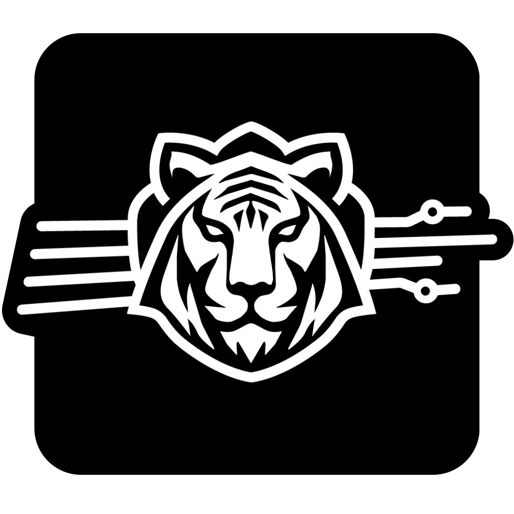

**Desktop companion for the [TigerTag](https://tigersystem.io) RFID filament-tracking ecosystem.**<br>
Manage your spool inventory, connect your 3D printers, and keep everything in sync — across devices, accounts, and friends.

<br>

<a href="https://github.com/TigerTag-Project/TigerTag-Studio-Manager/releases">
  
</a>
<br>
<a href="https://github.com/TigerTag-Project/TigerTag-Studio-Manager/releases">
  
</a>
<br>
<a href="https://github.com/TigerTag-Project/TigerTag-Studio-Manager/releases">
  
</a>

<br><br>

[](https://github.com/TigerTag-Project/TigerTag-Studio-Manager/releases/latest)

*Intel + Apple Silicon · macOS: Signed & Notarized · No installation knowledge required.*

<br>

[](https://github.com/TigerTag-Project/TigerTag-Studio-Manager/actions/workflows/build.yml)
[](LICENSE)
[](https://www.electronjs.org/)
[](https://nodejs.org/)

</div>

---

## What is it?

**[TigerTag](https://tigersystem.io)** is an open RFID standard for tracking 3D-printing filament spools. Each spool carries an NFC chip with its full profile — brand, material, color, print settings — readable by any compatible app or reader. The ecosystem includes the mobile app, an open-source scale, a color sensor, and this desktop companion.

Tiger Studio Manager is an Electron desktop app that bridges your physical filament collection with the TigerTag cloud. Scan a spool's NFC chip, see its full profile (material, color, weight, print settings), update its weight on the scale, and push filament data directly to your connected printers — all in one window.

Since **2.15.0** it does not even need a chip to know what a spool is: the official product catalogue is searchable
from inside the app, and any product in it can be added as a **TigerData+** — a fully-digital spool carrying that
product's real identity. Buy a chip when you want one on the shelf; until then, the app is no longer guessing.

It works standalone (no reader needed), but unlocks its full potential with:
- an **ACR122U NFC reader** for automatic spool identification, chip encoding and Cloud-to-chip promotion
- a **TigerScale** ESP32 scale for live weight tracking
- one or more **3D printers** — **about 380 models** with their picture: 7 brands connected natively (Bambu Lab, Creality, Elegoo, FlashForge, Snapmaker, Anycubic, Prusa) plus any **Klipper** or **OctoPrint** (Marlin) printer
- soon, a **[Tiger Touch](#-tiger-touch--every-printer-on-a-7-screen-coming-soon)** screen next to your printers

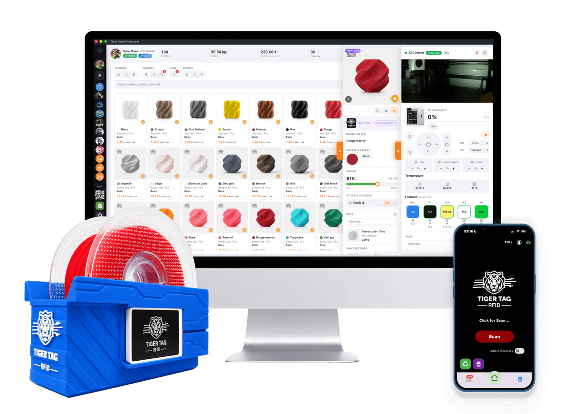

<p align="center"><em>…and the same thing on a real bench:</em></p>

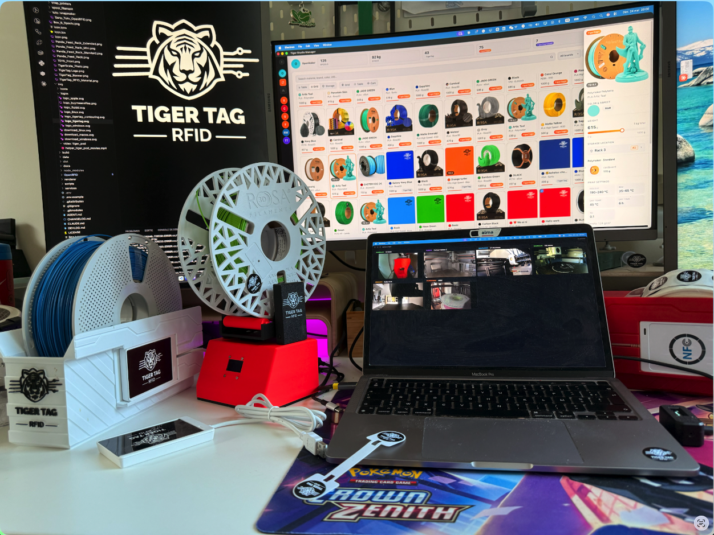

> 🌐 **[tigersystem.io](https://tigersystem.io)** — the ecosystem site: browse the filament catalogue, manage your account, get the apps.<br>
> 🛒 **[tigertag.io](https://tigertag.io)** — the shop: TigerTag chips, readers and sensors.

---

## A sandbox, not the product

Tiger Studio Manager is one piece of **TigerSystem**, the open ecosystem built around
the TigerTag protocol — and it is deliberately **a laboratory, not the destination**.

Everything you see here is a demonstration of what open, documented technology makes
possible once a filament spool can identify itself: live printer telemetry across seven
brands plus Klipper and OctoPrint, physical rack mapping, sensors, shared wishlists, chipless tracking. Some of it
will mature, some of it exists to prove a point, and all of it is readable, forkable and
free to copy.

The approach is **neutral and agnostic by design**. TigerTag takes no side between
filament brands, printer makers or distributors. It is not a walled garden with a
partner list — it is a format anyone can read and write.

> **Build your own.** TigerTag is an open protocol, not a platform you have to join.
> Nothing here is a prerequisite: read the [chip format](https://github.com/TigerTag-Project/TigerTag-RFID-Guide),
> pick up an [SDK](https://github.com/TigerTag-Project/TigerTag-SDK-JS), and build the
> software, the ecosystem or the business you actually want. This app is what *we*
> wanted — yours can be something else entirely, and it will still speak the same chips.

---

## Open source ecosystem

Everything around TigerTag is open — the hardware, the firmware, the SDK, and this app.

| Project | What it is | License |
|---|---|---|
| **[Tiger Studio Manager](https://github.com/TigerTag-Project/TigerTag-Studio-Manager)** | This app — desktop companion for filament management | MIT |
| **[TigerTag SDK for JavaScript](https://github.com/TigerTag-Project/TigerTag-SDK-JS)** | Parse, verify, and encode TigerTag NFC chips — used internally by this app | Apache-2.0 |
| **[TigerTag SDK for Python](https://github.com/TigerTag-Project/TigerTag-SDK-Python)** | Parse, verify, and encode TigerTag NFC chips in Python — for scripts, tools, and automation | Apache-2.0 |
| **[TigerScale V3](https://github.com/TigerTag-Project/Tiger-Scale-V3)** | ESP32-S3 firmware + hardware for the open-source filament scale — 3.5" touchscreen, dual NFC readers, battery | MIT |
| **[TigerSpool](https://github.com/TigerTag-Project/TigerSpool-RFID)** | Open-source RFID reader that sends a spool's filament to any printer's slot — ESP32-S3, NFC reader, 3D-printed case | MIT |
| **[Tiger Touch](https://github.com/TigerTag-Project/Tiger-Touch)** | Open firmware for the BIGTREETECH Panda Touch / K-Touch 7" screen — every printer of your TigerTag account, live, without a computer | MIT |
| **[TigerPOD](https://github.com/TigerTag-Project/TigerPOD)** | Open-source dual NFC reader/writer stand for spools — 3D-printable shell + two USB readers (free STL on MakerWorld: [Standard](https://makerworld.com/en/models/1289152-tigerpod-for-openspool-tigertag-rfid-filament#profileId-1318958) · [Mini](https://makerworld.com/en/models/3190348-tigerpod-mini-for-openspool-tigertag-rfid-filament#profileId-3609236)) | CC BY 4.0 |

The **TigerTag SDK** is the low-level library that handles all NFC chip operations — reading the 144-byte NTAG payload, verifying the TigerTag format, and encoding new chip data. It is published as an npm package (`tigertag`) and can be used independently to build custom TigerTag-compatible tools.

---

## Features

> The highlights below are a curated subset. See **[FEATURES.md](./FEATURES.md)** for the complete, always-current catalogue of every shipped feature — grouped by domain, with the version each one landed.

### 🗂 Inventory
- Real-time Firestore sync — table view + grid view, column sort, full-text search
- Detail side panel — color, print settings, weight slider with auto-save, container, raw JSON
- Weight tracking — slider or manual entry; instant cloud sync after update
- **Container weight calibration** — correct a container's empty weight against your own scale, with a guided "how to measure" step; kept on your account and applied to every spool in that container (the bundled catalogue is never modified)
- **The right container, every time** *(new in 2.35.0)* — a new spool gets its brand's empty spool for the weight maths, you are asked when there is a choice, and the MasterSpools you star are offered first for every refill
- **TigerData** — create fully-digital spools with no chip; promote to a real chip later, atomically
- **TigerData+** *(new in 2.15.0)* — a fully-digital spool that is nonetheless tied to a **real product in the official catalogue**: the exact brand, colour, material, temperatures, diameter, SKU and EAN, straight from the source instead of from whatever you typed. No chip to buy, nothing to stick on — and it is not a TigerTag+, so it carries its own badge and never pretends to be one
- **Catalogue search** *(new in 2.15.0)* — browse the whole official TigerTag+ catalogue from inside the app, in grid or list, filtered by type, brand, series and material. Pick a product to see its real spec sheet, then add it as a TigerData+ in one click, already filled in. The catalogue is downloaded once and searched locally, so it is instant and works offline
- **The catalogue travels with the app** *(new in 2.16.0)* — nearly 5 000 filaments ship inside the installer, so search works on the very first launch, offline, without waiting for a download. It still refreshes itself in the background
- **Find a filament by its barcode** *(new in 2.17.0)* — scan the EAN on the box with a barcode reader, or type it in, and the catalogue opens that product. The search also covers the reference, the series, the colour name, the finish, the product type and the weight
- **A card for every catalogue product** *(new in 2.35.0)* — open a product from the catalogue and add it to your inventory, a wishlist, your cart or your favourites in one click; nothing found? create the spool by hand from the same spot
- **Spools that keep themselves current** *(new in 2.16.0)* — when a brand corrects a temperature, a diameter or a colour name, the spools you own follow along on their own. Only a TigerTag+ can ever ask you for anything, and only when the change concerns something written on the chip itself
- **Photos framed in the spool's colour** *(new in 2.30.0)* — every spool photo sits in a frame of its own colour, in the grid, the lists, the catalogue and the details, so you spot the red one at a glance
- Custom product image for DIY & Cloud spools
- Manufacturing date, twin-tag detection and manual repair — chips written as a twin say so ("chip 1 of 2"), and the app asks for the second chip when only one has been scanned
- Spool toolbox — scan color (TD1S), scan TD, link twin, remove from rack, delete
- **One action row on every card** — the product card, the spool detail and the stack of identical spools all offer the same buttons, including a shopping button that opens the shop when the filament has a buy link (and takes you to where you'd add one when it hasn't)
- **Multi-select** — tick several spools (or printers) and delete them together, with a hold-to-confirm
- **Create and write the chip in one go** *(new in 2.31.0)* — with a TigerPOD or ACR122U reader plugged in, adding a material goes straight on to writing its NFC chip: a TigerTag by hand, a TigerTag+ from the catalogue
- **Link the chips already on your spools** *(new in 2.45.0, every brand in 2.46.1)* — any spool with a MIFARE Classic 1K chip (Bambu Lab, Creality, Qidi, Anycubic…) placed on the reader is linked to your material by its chip's ID (nothing written into it); from then on, placing it opens it like a TigerTag — alongside its TigerTag chips or on its own
- **NFC tools** *(new in 2.46.1)* — format your chips back to blank TigerTags, or write a link, a Wi‑Fi network, a contact, an e‑mail, a phone number or an SMS on any NFC tag (NTAG213 / 215 / 216); an Auto mode writes a whole batch, one chip after another
- **Guided chip update** — a step-by-step panel to re-write an existing chip: place it on the reader, UID-match check, verified write
- **Printed QR labels** *(new in 2.53.0)* — print a label for a spool or a filament in eight formats, from a 40 × 12 mm strip to a 50 × 30 mm card: brand, series, colour, the values you pick and a QR code. Scan a spool's label and it opens that very spool in Tiger Studio; save it as PDF, PNG or SVG for any printer
- **Restore a worn TigerTag+** *(new in 2.53.0)* — rewrite a worn or wiped TigerTag+ from its backup, after checking what comes back
- **Export / import `.ttag` files** — back up a spool or a whole selection to a portable file, keep it, carry it on a USB stick or share it, then import it back anywhere. Works for TigerData, TigerTag and TigerTag+ alike; import through a validate → preview → accept flow and choose **Restore** (put everything back exactly as it was) or **Import** (fresh spools you own). Pull in several files at once by browsing, pasting a link, or dragging them onto the window
- **Find a colour by pointing at it** — a rainbow bar and a white-to-black bar with a window you drag along them; spools in range stay lit and the rest fade, so you see *where* that orange actually sits. Works in Inventory, Favorites, the Catalogue and Storage alike

### 🖨 3D Printer integration
**About 380 printer models** in the catalogue, each with its picture — Bambu Lab X1C, P1S, P2S, A1, H2D; Creality K1, K1 Max, K2 Plus, Ender-3 V4; Elegoo Centauri Carbon and Centauri 2; Prusa MK4S, Core One, XL; FlashForge AD5X, Creator 5; Snapmaker U1; Anycubic Kobra 3; and through Klipper or OctoPrint, Voron, RatRig, Sovol SV08, Qidi, Neptune 4, Ender-3 and hundreds more.

Live integrations for 7 brands, plus **any Klipper printer** and **any Marlin printer behind OctoPrint** *(new in 2.41.0, beta)* — real-time temperatures, filament per slot, active print job, camera. **Bambu Lab printers can be added by signing in with your Bambu account**: your email, the code they send back, and every machine on the account is offered with its picture — reachable from anywhere, not only from your own network. Accounts on Bambu's **China mainland** platform sign in with their phone number.

**No printer yet? Try a demo one** *(new in 2.42.0)* — pick any of the ~400 models and Tiger Studio simulates it on its brand's real connection: it prints on its own, with temperatures, filament slots, camera, pause and stop. Each demo matches its model (an A1 mini has no AMS, an H2D two nozzles, a Prusa XL five heads).

Every brand at a glance:

| Brand | Protocol | Status |
|---|---|---|
| **Anycubic** | MQTTS 9883 (TLS) / cloud + ACE | ✅ Live |
| **Bambu Lab** | MQTTS 8883 (TLS) + AMS | ✅ Live |
| **Creality** | WebSocket 9999 + CFS | ✅ Live |
| **Elegoo** | MQTT 1883 + Canvas (Centauri Carbon 2) · SDCP 3030 (Centauri Carbon 1) | ✅ Live · CC1 🧪 Beta |
| **FlashForge** | HTTP polling 8898 + matlStation | ✅ Live |
| **Prusa** | PrusaLink HTTP 80 (MK4/MK4S, MK3.9, Core One, XL, MINI, MK3S+ via Pi) + MMU + Buddy3D camera | 🧪 Beta |
| **Snapmaker** | Moonraker WebSocket 7125 | ✅ Live |
| **Klipper** — any brand | Moonraker HTTP 7125 (Voron, RatRig, Sovol, Qidi, Neptune 4, K1…) + Happy Hare / AFC slots | 🧪 Beta |
| **OctoPrint** — Marlin printers | OctoPrint REST (OctoPi), no key to copy | 🧪 Beta |

**Can't remember which connection your printer uses? Just type its name** — the Add-a-printer card searches every brand at once, and when a machine can be reached more than one way (a Creality K1: Creality or Klipper) it lets you pick *(new in 2.41.0)*. Bambu Lab printers added from your account switch between **Cloud and LAN** from their settings — and on their own when one way stops answering *(new in 2.41.0)*.

Each brand supports: filament edit per slot, printer discovery (mDNS + port-scan + Add by IP), camera widget. When a scan finds several machines, **tick the ones you want and add them all in one go**. A **FlashForge Creator 5 / 5 Pro** tells you whether it runs the official Cloud + LAN firmware and hands you the latest version for your model *(new in 2.30.0)*.

The **Snapmaker U1** shows its camera even on the original Snapmaker firmware (about one picture a second, enough to watch a print); with the Paxx extended firmware it is smooth live video *(new in 2.33.0)*.

**Any IP camera on the wall** *(new in 2.45.0)* — add a workshop camera, a second angle on a printer or the one watching your front door (RTSP, MJPEG or WebRTC) from *Add a 3D printer → External cameras*; it sits on the camera wall and the printers board like a printer's camera.

The **printers table** shows, per printer: a live **print preview** (the model on the bed), the current job, and an **"Ends at"** column with the wall-clock finish time — plus per-printer **tags** and a search bar with **Brand / State / Tags** filters to manage a whole fleet.

Some brands also expose a **live control panel** (Snapmaker, Elegoo, Anycubic): home / jog the axes, set nozzle & bed targets, toggle the light, control the part-cooling fan, pick the print-speed mode, and load / unload filament per slot.

The **printer board** lays your fleet out the way your workshop actually looks: place every machine by hand on a plan you zoom and pan, and it stays where you put it — a printer going offline no longer changes place. Beside each machine you can show its **filament units** (Ext., AMS 1, AMS 2, CFS, ACE…) as separate boxes with their slots, colours and materials at the same size as your storage racks, and a **temperature widget** that stays put when the printer sleeps. Cards can be **grouped for good**, so moving one carries the whole set.

The **camera view** works the same way: drag each camera where you want it, pull its corner to give it exactly the size it deserves, and use **Arrange** to snap them against each other with the same grid and guides as the other two plans. A camera keeps its place and its size while its printer sleeps, and one sent fullscreen fills the whole screen.

Each machine's card can also show **what it is printing** — preview, percentage, time left, finish time and layers — and **its camera**: hover the printer's photo, press play, and the photo gives way to the live feed. **Pause and stop** sit on the card while it prints, so you never have to go looking for the machine. Nothing streams until you ask for it — or, for the printers you choose, **the camera starts on its own** as soon as the printer is online *(new in 2.43.0)* — and the board, the camera wall and the printer's own page share a single connection to each machine. Hover any camera to **take a photo or record a video**: full quality, filed per printer *(new in 2.43.0)*.

### 📦 Storage / Racks

<p align="center">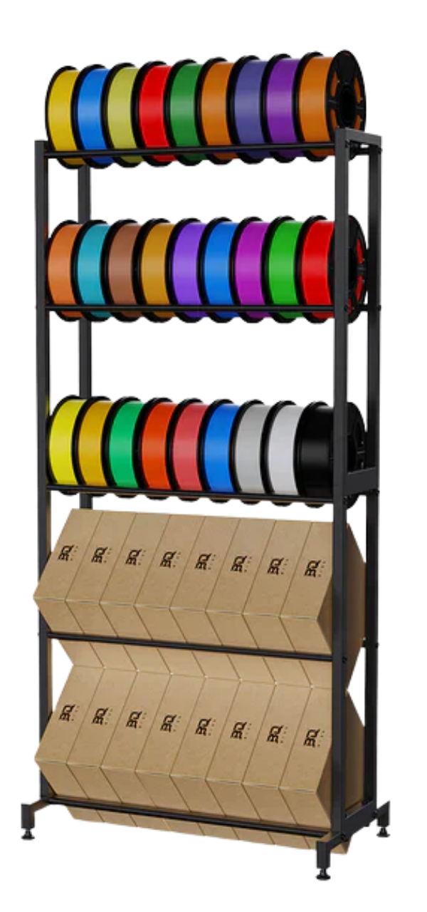</p>

Organize your filament collection into physical racks — drag spools onto slots, auto-fill from inventory, and always know where each spool sits:
- **Storage plan** — place each rack where it really stands: drag it by its header, and it snaps to its neighbours' edges as you go. Nothing else on the board moves, and the arrangement follows your account
- **Rack depth** — up to three rows of spools one behind the other, drawn in perspective so the one at the back stays readable
- **Drag-and-drop rack editor** — slot locking, auto-fill / auto-store
- **Rack builder** — a three-step side card: name and subtitle, levels, slots per level and rows deep with − / + steppers, and a live preview that shows an existing rack's real contents while you resize it
- **Unranked panel** — spools not yet assigned to a rack, always visible at a glance
- **Rich hover tooltip** on filled slots — color swatch, weight bar, brand, and coordinates

### 🤝 Friends & Sharing
- Discovery code `XXX-XXX` — share with friends for O(1) lookup
- Send / accept / refuse / block friend requests
- View a friend's inventory in read-only mode, inline in the same UI
- Public inventory toggle for frictionless sharing

### 🐯 TigerSquad
- Join the TigerSquad for free — the community of makers behind open 3D printing, with a public [wall of fame](https://tigersystem.io/en/tigersquad)
- Four levels shown as a badge on your avatar: Bronze, Silver (20 TigerTag chips), Gold (a coffee), Platinum (a coffee + 50 certified TigerTag+)
- XP for every TigerTag chip you own — certified TigerTag+ count the most — to rank the makers
- XP for exploring the ecosystem too — friends, printers, a TigerScale, the phone app and more
- Rankings: three leagues side by side — countries, your country and makers worldwide — with daily up / down arrows and the live community pulse
- Tiger Quests: daily quests with a bonus chest and streaks, and tutorial missions that show you around the app for XP
- Your XP history: a balance curve (yours, your country's or the top leagues'), the breakdown by category and every transaction
- Deals: partner offers for squad members — get your code, use it, keep your history
- TigerCoins and envelopes: each certified TigerTag+ chip hides an envelope; open them, win TigerCoins, trade them for deals, give envelopes to your friends
- The Maker's Workshop: your loot and feats, from common to legendary
- Treasure hunt *(new in 2.50.0, was Trophies)*: a sticker album to fill under an explorer's banner — each sticker downloadable, some veiled until a friend holds them
- Invite a friend *(new in 2.49.0)*: share your link or QR code; once your friend confirms their e-mail, you both get 3 envelopes
- Send TigerCoins *(new in 2.49.0)* to a squad friend, with a message that opens as a letter
- TigerSquad updates *(new in 2.50.0)*: the squad asks for a newer app when it needs one; leaving it has a 30-day wait; give several envelopes at once
- Account deletion *(new in 2.51.0)*: delete your account from Studio, with a re-sign-in, a typed word and a held button
- Countries League *(new in 2.51.0)*: pick your flag from a window, peek at another country's league; the flag moves once every 30 days

### ⚖ Sensors & Devices

#### ACR122U NFC reader
Plug in a USB ACR122U reader and the app automatically opens the matching spool's detail panel the moment you scan a chip — no button, no search, instant access.

#### 🧵 TigerSpool — the RFID reader for every 3D printer
The **TigerSpool** ([repository](https://github.com/TigerTag-Project/TigerSpool-RFID)) is a cheap, easy-to-build open-source box that sits next to your printers: rest a TigerTag spool against it and it fills your printer's slot — material, colour, temperatures — like a native reader, on Bambu Lab, Creality, Elegoo, FlashForge, Snapmaker and Anycubic. Studio shows each box live in the header (status, battery, the printers it serves). Print the desktop stand free on MakerWorld: [spool on the left](https://makerworld.com/models/3360492-tigerspool-desktop-stand-spool-on-the-left) · [spool on the right](https://makerworld.com/models/3360619-tigerspool-desktop-stand-spool-on-the-right).

#### 🐯 TigerPOD — free 3D-printable dual reader stand

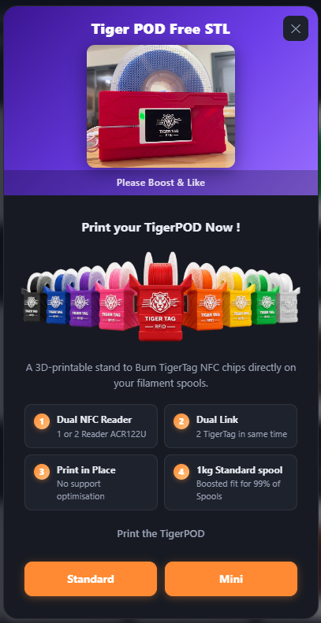

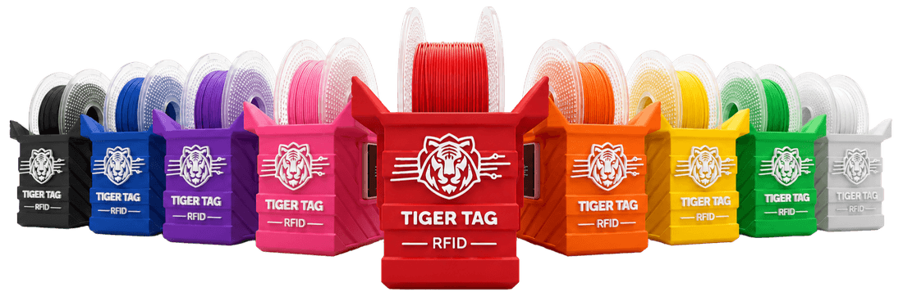

The **TigerPOD** ([repository](https://github.com/TigerTag-Project/TigerPOD)) is a free 3D-printable stand designed to hold up to **two ACR122U readers** side by side. Place one or two TigerTag chips on it and encode both in a single click directly from Tiger Studio Manager — no manual positioning, no juggling readers.

| | |
|---|---|
| **Print** | No supports needed — print in place, fits 99 % of 1 kg standard spools |
| **Readers** | 1 or 2 × ACR122U — encode two chips simultaneously (Dual Link) |
| **License** | Free — download, print, use |

<p align="center">
  <a href="https://makerworld.com/en/models/1289152-tigerpod-for-openspool-tigertag-rfid-filament#profileId-1318958"></a>
  <a href="https://makerworld.com/en/models/3190348-tigerpod-mini-for-openspool-tigertag-rfid-filament#profileId-3609236"></a>
</p>

#### TD1S color sensor

<p align="center">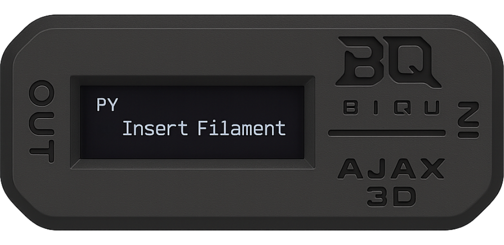</p>

The [TD1S](https://tigertag.io/products/biqu-ajax-td1s-v1-0) is TigerTag's USB filament color and transmission density sensor. Place the filament in the sensor and it reads:
- **Color** — precise HEX value written directly to the spool's `online_color_list`
- **TD value** — Transmission Density, a measure of filament transparency used by compatible slicers

The TD1S auto-opens a live viewer when plugged in. In the spool detail panel, scan color and TD separately or together. In the **Add Product** panel, the TD1S icon in the header glows green when connected — scanning auto-fills both fields in the form.

#### TigerScale

<p align="center"></p>

The [TigerScale](https://github.com/TigerTag-Project/Tiger-Scale-V3) is an open-source ESP32 filament scale — now in its **V3** generation (ESP32-S3, 3.5" touchscreen, dual PN532 readers, battery). Tiger Studio Manager connects to it over WebSocket and shows a live card per scale:
- **56 px live weight display** with container / filament split
- **Send-status badge** — tracks the firmware lifecycle: `idle → scanning → stable → send → success`
- **Filament mini-panel** — color dot, brand, and material pushed directly from the scale firmware
- **Twin UID reader grid** — two NFC readers (left / right); the empty slot auto-fills with the Firestore-resolved twin tag in green
- **TARE** — hold-to-confirm button (1 s) that POSTs `/api/tare` to the scale firmware

#### USB scale (Dymo M-series)

Plug in a **Dymo USB scale** and your spool weights fill themselves in — no typing. Set a spool on the scale and, with a chip on the reader, its weight is saved automatically (gross → net, twin synced); with a spool's card open, a quick confirm does it. The live reading appears right inside the spool's weight panel, and a dimmed "asleep — tap to wake" hint shows when the scale powers itself down.

### 🖥 Tiger Touch — every printer on a 7" screen
**Tiger Touch** is a new open-source firmware (MIT) for the **BIGTREETECH Panda Touch / K-Touch**, the 7" ESP32-S3 touchscreen. It signs in to your TigerTag account, reads every printer you declared in Tiger Studio and talks to each one directly over its own protocol — Bambu Lab, Creality, Elegoo, FlashForge, Snapmaker, Prusa, Anycubic, and any Klipper or OctoPrint printer. No computer, no bridge, no server in between: just Wi-Fi.

- **A live card per printer** — state, progress, file, layer, time left and the finish time, nozzles, bed, chamber.
- **A full view per printer** with its filament units: AMS, AMS HT, CFS, external spool, up to four tool heads.
- **Pause, resume, stop and the light**, from the card or the full view.
- **Installed from the browser, updated over the air**, in 11 languages.

Add your printers once in Tiger Studio; they show up on the screen by themselves. In Tiger Studio, the screen gets its own card: the printers it follows, a live view you can touch with the mouse, and a screenshot ready to share or attach to a bug report. **Available now** — [install it from your browser](https://tigertag-project.github.io/Tiger-Touch/) (USB, no tools), source on [GitHub](https://github.com/TigerTag-Project/Tiger-Touch).

### 📱 TigerTag RFID Connect — mobile app
Tiger Studio Manager is the desktop companion to **TigerTag RFID Connect**, the iOS/Android mobile app. Both apps share the same Firebase backend (Firestore inventory, friends, racks) so changes made on one device appear immediately on the other.

The mobile app handles chip programming, NFC scanning on the go, and catalogue browsing. Tiger Studio Manager adds the desktop-class surfaces: multi-account management, rack organization, live printer integration, TD1S and TigerScale hardware, and bulk operations.

A QR code to download the mobile app is always accessible in the sidebar.

### 💬 Feedback, straight from the app

- **Improvements & suggestions** *(new in 2.36.0)* — report a problem, suggest an idea, fix a catalogue product or suggest a missing brand without leaving the app (and without a GitHub account): annotate a screenshot of the window — arrows, steps, a blur for anything private — attach images or PDFs, and follow every request in *My requests*, with a notification when it moves
- **Requests by product** *(new in 2.42.0)* — say what it's about (Tiger Studio, Tiger Touch, Tiger POD, Tiger Scale, Tiger Spool or the mobile app) and it is filed on that project; a Tiger Touch, Tiger Scale or Tiger Spool screen joins the report in one click, with the printers the device follows.
- **Request conversations** *(new in 2.49.0)* — read the team's replies and answer from the app, browse everyone's requests and answer the community's questions

### 🤖 AI assistants
- Ask **Claude, Cursor or VS Code** about your stock — "what PLA am I low on?", "what does my friend have in black PETG?"
- One-click install per app, turned on per profile in *My profile*
- **Read-only** and local: the assistant can look, never change; passwords and keys are never shared
- **From the web and your phone too**: Claude.ai, ChatGPT and their mobile apps connect online with one address — no Studio running — and *My profile* lists them with a button to cut access

### 🌐 Tiger Studio Web
- The same Studio **in your browser** at **[studio.tigersystem.io](https://studio.tigersystem.io)** — computer, tablet, nothing to install
- Same account, same data — sign in once, Studio Web remembers you
- At home on an **iPad**, portrait or landscape — no mouse needed
- **Install it as an app** from the sidebar (Chrome, Edge, Android) or *Add to Home Screen* on iPhone / iPad
- Always on the same version as the desktop app; NFC readers, sensors and printers stay desktop-only for now

### 🌗 Dark & Light
- **Dark by default**, Light one click away in *Edit profile → Theme*
- Your choice follows your account onto every machine you sign in from
- The native window chrome follows the theme too — no white UI in a black title bar

### 🌍 Accounts & i18n
- Multi-account — switch between multiple TigerTag accounts
- **11 locales** — EN · FR · DE · ES · IT · PL · PT (Brasil) · PT (Portugal) · 中文 · RU · NL
- Per-account language preference synced with Firestore
- Google sign-in via loopback OAuth (RFC 8252 + PKCE) — Touch ID / passkey native support

---

## Screenshots

<div>

| Inventory | Printers |
|---|---|
| 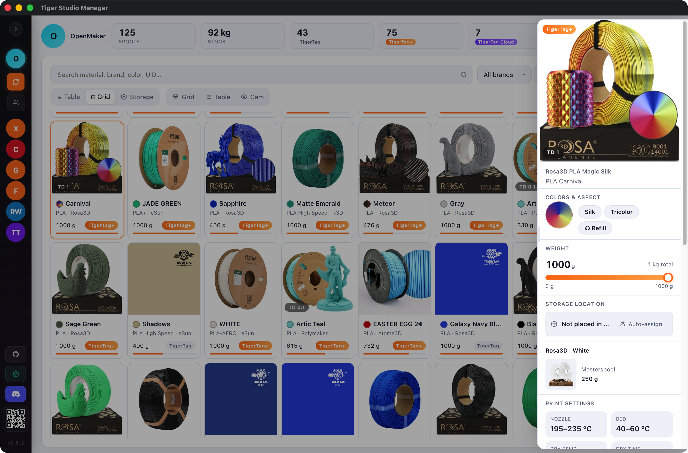 | 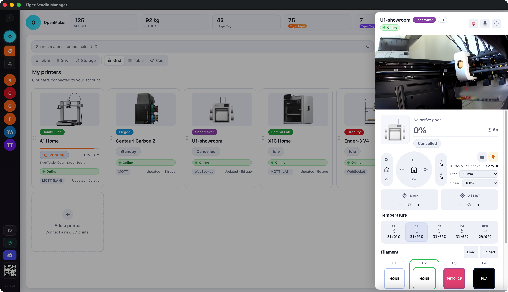 |

| Storage Racks | Camera Wall |
|---|---|
| 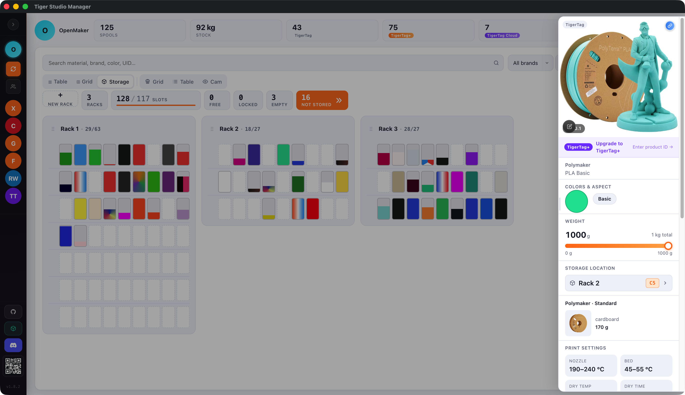 |  |

| TD1S color sensor | TigerPOD |
|---|---|
| 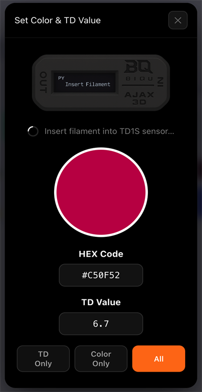 |  |

</div>

---

## Getting started

### Requirements

- **Node.js** 24+
- **npm** 10+
- A **TigerTag account** — [tigersystem.io](https://tigersystem.io)
- _(Optional)_ An **ACR122U** NFC reader for chip read/write

#### Linux only

```bash
sudo apt-get install libpcsclite-dev libusb-1.0-0-dev build-essential
```

### Install & run

```bash
git clone --recurse-submodules https://github.com/TigerTag-Project/TigerTag-Studio-Manager.git
cd TigerTag-Studio-Manager
npm install   # also runs electron-rebuild for native NFC module
npm start
```

---

## Tech stack

| Layer | Technology |
|---|---|
| Desktop shell | [Electron](https://www.electronjs.org/) 41 |
| UI | Vanilla HTML / CSS / JavaScript (no framework, no bundler) |
| Auth & data | [Firebase](https://firebase.google.com/) (Auth + Firestore) |
| NFC reading | [nfc-pcsc](https://github.com/pokusew/nfc-pcsc) + ACR122U |
| NFC parsing | [TigerTag SDK for JavaScript](https://github.com/TigerTag-Project/TigerTag-SDK-JS) — parse, verify, write TigerTag chips |
| Auto-update | [electron-updater](https://www.electron.build/auto-update) via GitHub Releases |
| Build & packaging | [electron-builder](https://www.electron.build/) |
| macOS signing | Apple Developer ID + `notarytool` (App Store Connect API Key) |
| Windows signing | Not yet signed (planned — Microsoft Trusted Signing) |
| CI / Releases | GitHub Actions — triggered on `v*` tag push |

---

## Building installers

Push a `v*` tag to trigger a parallel build on all three platforms and publish a GitHub Release automatically:

```bash
git tag v1.7.0
git push origin v1.7.0
```

| Platform | Command | Output | Signed |
|---|---|---|---|
| macOS (signed) | `npm run build:mac` | `.dmg` + `.zip` (x64 + arm64) | ✅ Developer ID + Notarized |
| macOS (fast, local) | `npm run build:mac:unsigned` | `.dmg` | ❌ |
| Windows | `npm run build:win` | `.exe` NSIS | ❌ Not yet signed |
| Linux | `npm run build:linux` | `.AppImage` | N/A |
| All | `npm run build:all` | All three | — |

Built artifacts go to `dist/` (git-ignored).

> `npm run build:mac` requires Apple Developer credentials in a local `.env` file (see `.env.example`). The signing + notarization pipeline is documented in `docs/code-signing.md`.

---

## i18n tooling

UI strings live in `renderer/locales/<lang>.json`. Never edit the 11 locale files by hand — use the helper instead:

```bash
# Add a new key across all 11 locales
npm run i18n:add -- myKey en="Hello" fr="Bonjour" de="Hallo" \
  es="Hola" it="Ciao" zh="你好" pt="Olá" pt-pt="Olá" pl="Cześć" ru="Привет" nl="Hallo"

# Insert after an existing key (keeps related keys grouped)
npm run i18n:add -- myKey --after toolboxTitle en="Hello" ...

# Check consistency (also runs automatically as a pre-commit hook)
npm run i18n:check
```

The pre-commit hook blocks any commit that leaves locale files inconsistent (missing keys, type mismatches, empty strings). It is activated automatically by `npm install` via the `prepare` script.

---

## Multi-vendor RFID (planned)

The app currently reads only TigerTag chips. Per-vendor spec sheets for extending support are in `docs/rfid-vendors/`:

| Vendor | Tag type | Auth | Spec |
|---|---|---|---|
| 🐯 TigerTag | NTAG/NDEF | None | [tigertag.md](./docs/rfid-vendors/tigertag.md) |
| 🟢 Bambu Lab | Mifare Classic 1K | HKDF-SHA256 | [bambu.md](./docs/rfid-vendors/bambu.md) |
| 🟠 Creality | Mifare Classic 1K | AES-128-ECB | [creality.md](./docs/rfid-vendors/creality.md) |
| 🔴 Anycubic | Mifare Ultralight | None | [anycubic.md](./docs/rfid-vendors/anycubic.md) |
| ⚫ Elegoo | Mifare Ultralight | Magic bytes | [elegoo.md](./docs/rfid-vendors/elegoo.md) |
| 🟣 Snapmaker | Mifare Classic 1K | HKDF + RSA-2048 | [snapmaker.md](./docs/rfid-vendors/snapmaker.md) |
| 🟡 Qidi | Mifare Classic 1K | Default key | [qidi.md](./docs/rfid-vendors/qidi.md) |
| 🌐 Openspool | NFC Type 2 NDEF | None | [openspool.md](./docs/rfid-vendors/openspool.md) |

The [OpenRFID](https://github.com/suchmememanyskill/OpenRFID) project is vendored as a Git submodule under `OpenRFID/` as a read-only reference.

---

## Project structure

```
TigerTag-Studio-Manager/
├── main.js                  # Electron main process (IPC, printer transports, NFC, cameras) — see CODEMAP-main.md
├── preload.js               # contextBridge IPC
├── CODEMAP-main.md          # Line-range index for main.js
├── ROADMAP.md               # Done / next / backlog by domain
├── services/
│   ├── nfc-process.js       # NFC utilityProcess — nfc-pcsc read/write, isolated from the main process
│   ├── tigertagDbService.js # Reference data layer (API → GitHub mirror → userData → assets)
│   └── anycubicCloudCerts.js
├── renderer/
│   ├── inventory.html       # Single-page UI markup
│   ├── inventory.js         # Core renderer logic (~21k-line ES module — see CODEMAP.md)
│   ├── CODEMAP.md           # Line-range index for inventory.js (read first, grep last)
│   ├── firebase.js          # Firebase init (public config)
│   ├── css/                 # 10 themed files, loaded in order (00-base → 10-settings → … → 70-detail-misc)
│   ├── locales/             # i18n JSON — en fr de es it zh pt pt-pt pl ru nl (11 locales, edit via npm run i18n:add)
│   ├── IoT/                 # Extracted device modules (own CSS inside each)
│   │   ├── tigerscale/      # TigerScale — Firestore subscription, panel, health tick
│   │   └── td1s/            # TD1S color/TD sensor engine + TD/Color edit modals
│   ├── rfid_protocol/
│   │   └── tigertag/        # RFID TigerTag tester modal + chip parser
│   ├── cam/                 # Detached camera-wall window
│   └── printers/            # Per-brand live integrations + PROTOCOL.md agent skills
│       ├── anycubic/  bambulab/  creality/  elegoo/  flashforge/  snapmaker/
│       └── registry.js  context.js  cam_manager.js  modal-helpers.js  extra-subnets.js   # shared
├── assets/
│   ├── db/tigertag/         # Bundled reference JSONs (id_brand, id_material, …)
│   ├── img/                 # App icons + printer photos
│   └── svg/                 # UI icons + TigerTag logos
├── data/
│   ├── container_spool/     # Spool container catalog
│   ├── printers/            # Per-brand printer model catalogs
│   ├── rack-presets.json    # Built-in rack templates
│   ├── whatsnew.json        # "What's New" modal content (11 locales, full history)
│   └── release-notes/       # Per-version GitHub Release body (BambuLab-style)
├── scripts/                 # i18n add/check, whatsnew add/check, codemap check, changelog extract, …
├── docs/
│   ├── firestore-schema.md  # Full Firestore collection/field map
│   ├── i18n-keys.md         # i18n key reference
│   └── rfid-vendors/        # Per-vendor RFID spec sheets
├── OpenRFID/                # Git submodule — upstream multi-vendor parsers (read-only)
└── .github/workflows/
    └── build.yml            # CI: prepare-release (draft + notes) → parallel build → attach assets, on tag push
```

---

## FAQ

**Which 3D printers does Tiger Studio Manager support?**
About 380 models. Bambu Lab, Creality, Elegoo, FlashForge, Snapmaker, Anycubic and Prusa are connected natively over the local network (Bambu Lab and Anycubic also through their cloud). Any printer running **Klipper** (Moonraker) or **Marlin behind OctoPrint** works too — Voron, RatRig, Sovol, Qidi, Elegoo Neptune 4, Creality Ender-3 and many more. Type the printer's name in the Add-a-printer card and it finds the right connection.

**Do I need TigerTag RFID chips to use it?**
No. Any spool can be added from the official catalogue (14 000+ products) or by hand. Chips add automatic identification: scan the spool and its page opens.

**Is it free and open source?**
Yes — MIT licensed, for macOS, Windows and Linux, and also usable in the browser at [studio.tigersystem.io](https://studio.tigersystem.io).

**Can I see my printers without a computer?**
Soon: **Tiger Touch** turns a BIGTREETECH Panda Touch / K-Touch screen into a live monitor for every printer of your account. The **TigerTag RFID Connect** mobile app already shows your inventory on the go.

**What does it do with filament on the printer?**
It shows the filament loaded in every slot (AMS, CFS, Canvas, ACE, MMU, Happy Hare, AFC…), lets you edit it, and — with a TigerSpool reader — fills a slot from a TigerTag spool like a native reader.

## Contributing

1. **Fork** the repository
2. **Create a branch**: `git checkout -b feat/my-feature`
3. **Make your changes** — vanilla JS, no frameworks
4. **Run**: `npm start` to test locally
5. **Open a Pull Request**

Guidelines: keep the renderer vanilla (no React/Vue), add i18n strings with `npm run i18n:add` (all 11 locales), don't commit `node_modules/` or `dist/`.

**Reporting issues** — use [GitHub Issues](https://github.com/TigerTag-Project/TigerTag-Studio-Manager/issues). Use **Settings → Debug → Report a problem** in the app to copy a self-contained diagnostic report (version, platform, last 50 errors) to paste into your issue.

---

## Changelog · Roadmap

- 📚 **[FEATURES.md](./FEATURES.md)** — complete catalogue of every shipped feature, grouped by domain (current as of the latest release)
- 📋 **[CHANGELOG.md](./CHANGELOG.md)** — full version history
- 🗺 **[ROADMAP.md](./ROADMAP.md)** — planned features, in-flight work, and backlog

---

## Support the project

TigerSystem is a personal, community open-source project, built and maintained in free time.
Everything stays free; if it saves you a spool or two, you can support it:

- ☕ [Buy Me a Coffee](https://buymeacoffee.com/benoitl)
- ❤️ [Ko-fi](https://ko-fi.com/tigersystemio)
- 💙 [PayPal](https://paypal.me/tigersystemio)

Linked to your account, a donation lifts you to **Gold** in the [TigerSquad](https://tigersystem.io/en/tigersquad).

Support goes to the maintainer — never required, always appreciated.

## License

[MIT](LICENSE) — © TigerTag Project

You are free to use, modify, and distribute Tiger Studio Manager — including commercially.
The **"TigerTag"** name is a trademark of the TigerTag Project — see [TRADEMARK.md](TRADEMARK.md) for usage conditions.
All npm dependencies are permissive (MIT / ISC / BSD / Apache) — see [THIRD_PARTY_LICENSES.md](THIRD_PARTY_LICENSES.md).
